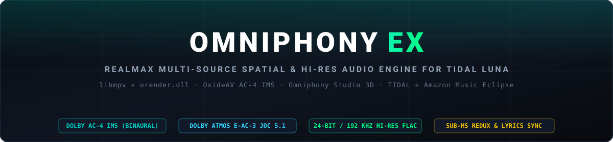
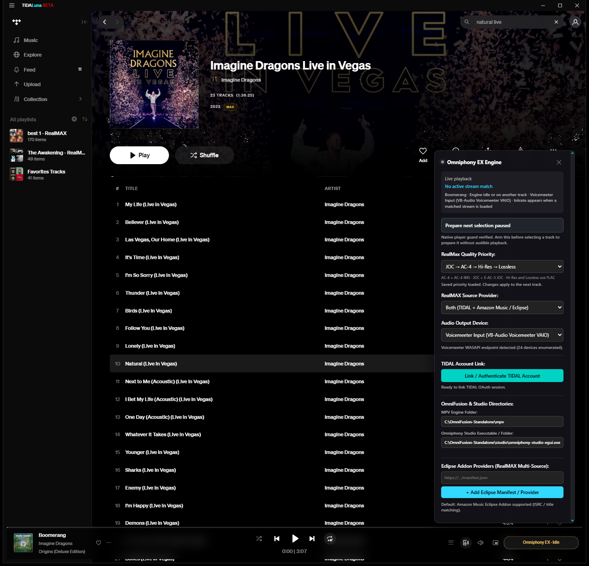
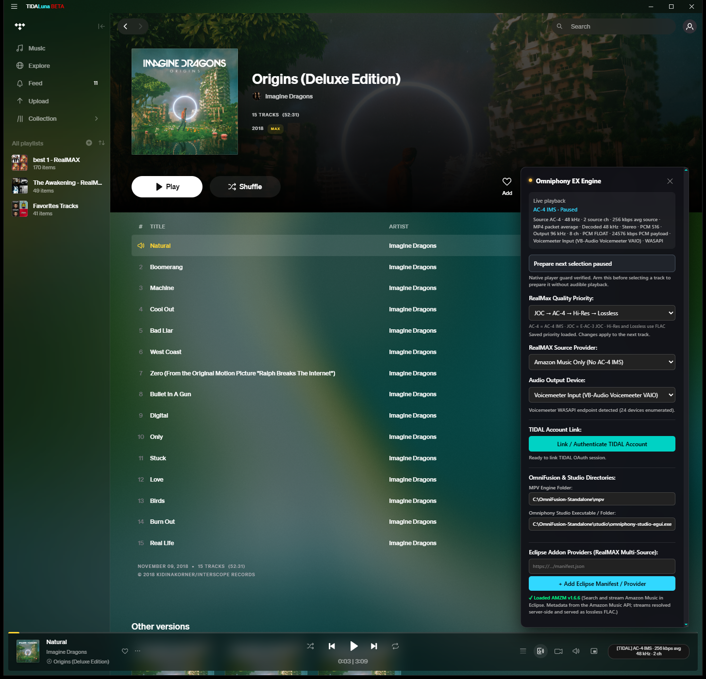
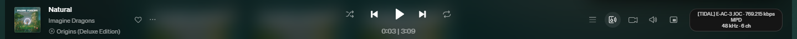
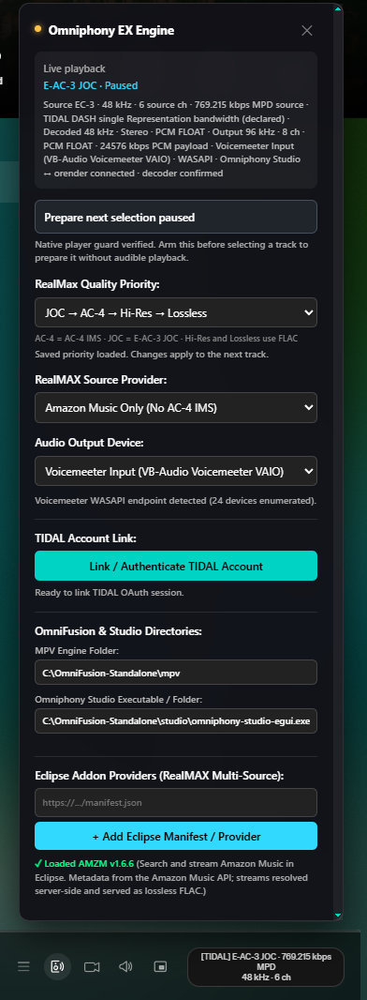
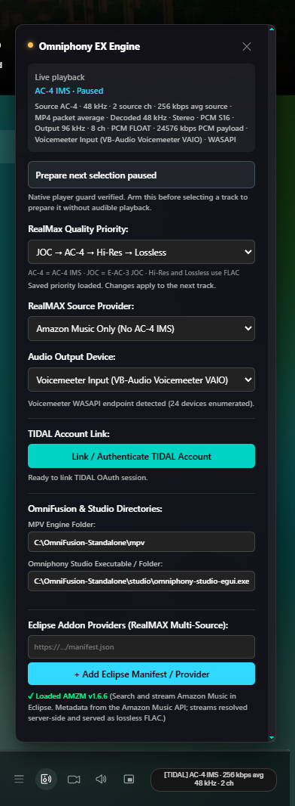
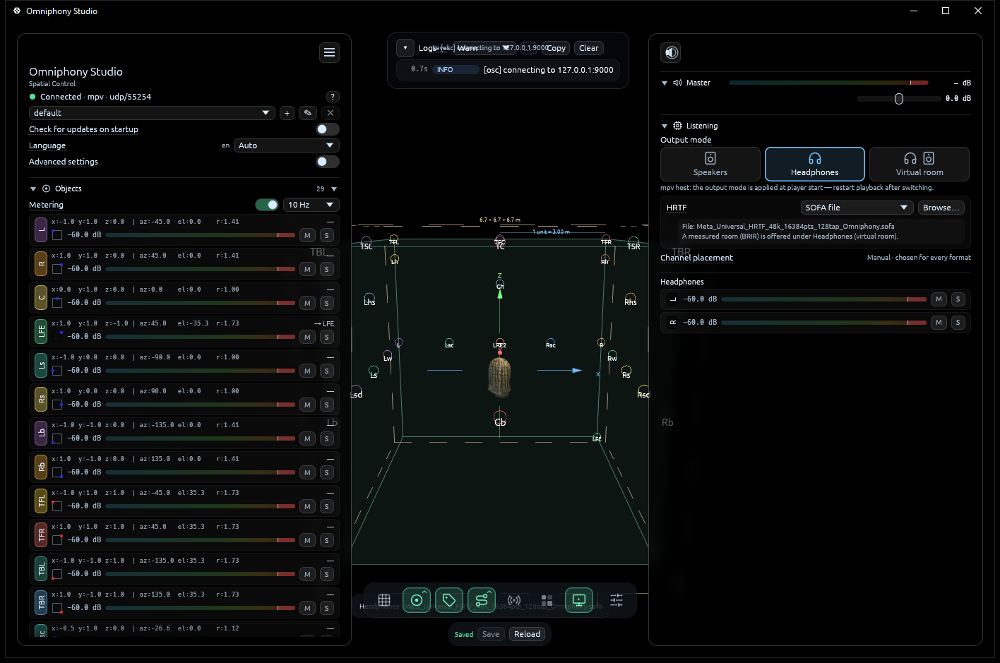
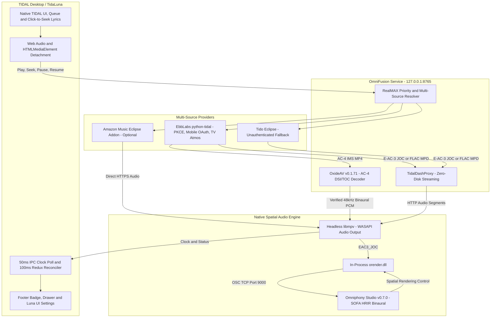

<div align="center">



<br />

[](https://github.com/Cxsmo-ai/omniphony-tidal-luna-plugin)
[](https://github.com/Cxsmo-ai/omniphony-tidal-luna-plugin/releases/tag/v2.1.25)
[](docs/ARCHITECTURE.md)
[](docs/ARCHITECTURE.md)
[](docs/ARCHITECTURE.md)

</div>

---

## Overview

**Omniphony EX** upgrades the official Windows **TIDAL Desktop** client (running **TidaLuna**) with a dedicated, multi-source spatial and Hi-Res audio engine (**OmniFusion Standalone Audio Engine**) while preserving 100% of native TIDAL UI behavior.

- **True Bit-Accurate & Spatial Playback:** Routes audio through headless **`libmpv`**, **OxideAV** (`AC-4 IMS` binaural stereo decoder), and in-process **`orender.dll`** connected to **Omniphony Studio** (`E-AC-3 JOC` 3D object spatializer with SOFA HRIR binaural headphone rendering).
- **Deep Web Audio Detachment (No OS Muting):** Detaches TIDAL's internal Chromium media output cleanly without muting your Windows mixer or breaking TIDAL's internal player state.
- **Sub-Millisecond UI & Lyrics Sync:** Polls `libmpv` IPC at 50 ms cadence and reconciles TIDAL Redux / Radiant player clocks every 100 ms—keeping word-by-word synced lyrics, click-to-seek lyrics, waveform scrubbing, and seamless queue auto-advance 1:1 with the audio engine.
- **RealMAX Multi-Source Resolution:** Dynamically evaluates all 24 user-selectable format priority orders across **TIDAL** (`EbbLabs/python-tidal`), user-supplied **Amazon Music Eclipse** addons, and an automatic **Tido Eclipse** fallback when the main TIDAL API is not yet linked.

---

## Live Screenshots & Real UI Walkthrough

All screenshots below are real captures taken directly from a live Windows 11 session running **TIDAL Desktop (TidaLuna Beta)**, **Omniphony EX v2.1.19**, **OmniFusion Service v2.1.25**, and **Omniphony Studio v0.7.0**.

### 1. Live TIDAL Desktop — Dolby Atmos `E-AC-3 JOC` (`769.215 kbps MPD · 48 kHz · 6 ch`)
*Full TIDAL Desktop window playing Imagine Dragons — Natural with the Omniphony EX Engine drawer open and the native bottom-right footer badge displaying live E-AC-3 JOC telemetry and confirmed `Omniphony Studio ↔ orender` connection.*

<p align="center">
  
</p>

### 2. Live TIDAL Desktop — Dolby Atmos `AC-4 IMS` (`256 kbps avg · 48 kHz · 2 ch`)
*Full TIDAL Desktop window playing Imagine Dragons — Natural in verified Dolby AC-4 Immersive Stereo (`AC4_IMS`), decoded via OxideAV into 48 kHz binaural stereo.*

<p align="center">
  
</p>

### 3. Native Footer Telemetry Bar Across Formats & Providers
*Real close-up captures of the TIDAL player footer bar showing how the bottom-right Omniphony EX badge adapts across `[TIDAL] E-AC-3 JOC`, `[TIDAL] AC-4 IMS`, and `[AMAZON] Lossless / Hi-Res FLAC`:*

**`[TIDAL] E-AC-3 JOC · 769.215 kbps MPD · 48 kHz · 6 ch`**
<p align="center">
  
</p>

**`[TIDAL] AC-4 IMS · 256 kbps avg · 48 kHz · 2 ch`**
<p align="center">
  
</p>

**`[AMAZON] Lossless FLAC · 1692.357 kbps reported · 44.1 kHz · 2 ch · 16-bit`**
<p align="center">
  
</p>

### 4. In-TIDAL Omniphony EX Control Drawer (`E-AC-3 JOC` vs. `AC-4 IMS`)
*Side-by-side real captures of the floating Omniphony EX settings drawer showing live source/decoded/output telemetry, paused preparation control, 24-order RealMAX priority selector, RealMAX Source Provider selector (`Both` / `TIDAL Only` / `Amazon Music Only`), WASAPI device selector, 1-click TIDAL OAuth link, engine paths, and Eclipse addon manifest loader:*

| `E-AC-3 JOC` Active (`Omniphony Studio ↔ orender` Confirmed) | `AC-4 IMS` Active (`OxideAV` MP4 Packet Average Confirmed) |
| :---: | :---: |
|  |  |

### 5. Omniphony Studio 3D Spatial Renderer (`Connected · mpv · SOFA HRIR Binaural`)
*Real capture of `omniphony-studio-egui.exe` connected to `libmpv` over loopback OSC (`127.0.0.1:9000`), rendering full 3D object-based audio, any speaker layout (`2.0` through `5.1.2`, `7.1.2`, `7.1.4`, `9.1.6`, `22.2`, or custom 3D speaker layouts), and direct SOFA HRIR binaural headphone rendering through the bundled Meta Audio SDK HRTF (`assets/hrtf/Meta_Universal_HRTF_192k_16384pts_512tap_32bit_Omniphony.sofa`):*

<p align="center">
  
</p>

---

## Architecture & Signal Pipeline



---

## RealMAX Format Priority & Multi-Source Routing

### Supported Audio Formats & Verification Gates

| Priority Token | Format Name | Encoded Input | Channels & Sample Rate | Decoding & Verification Pipeline |
| :--- | :--- | :--- | :--- | :--- |
| **`AC4_IMS`** | **Dolby AC-4 IMS** *(Immersive Stereo)* | Dolby AC-4 (`ac-4`) | 2 ch Binaural · 48 kHz · ~256–320 kbps | **TIDAL Exclusive.** Verified via MP4 `dac4` DSI + bitstream TOC probe, decoded via **OxideAV** (`ac4-to-wav`) into 48 kHz binaural stereo. |
| **`EAC3_JOC`** | **Dolby Atmos** *(E-AC-3 Joint Object Coding)* | Dolby Digital Plus Atmos (`ec-3` / `eac3_joc`) | 6 ch (5.1 + JOC objects) · 48 kHz · ~768 kbps | Decoded in-process by `libmpv` (`--ad=orender`) with mandatory fail-closed verification of the live **Omniphony Studio** OSC link (`127.0.0.1:9000`) and SOFA HRIR binaural configuration. |
| **`HI_RES_LOSSLESS`** | **Hi-Res Lossless FLAC** *(Max / Ultra HD)* | Free Lossless Audio Codec (`flac`) | 2 ch · 24-bit / up to 192 kHz · ~1,600–9,200 kbps | Streamed directly over HTTPS (`DIRECT`) or loopback `TidalDashProxy` (`DASH`) with zero WAV disk conversion. |
| **`LOSSLESS`** | **Lossless FLAC** *(CD Quality)* | Free Lossless Audio Codec (`flac`) | 2 ch · 16-bit / 44.1 kHz · ~850–1,411 kbps | Bit-exact 16-bit/44.1 kHz lossless FLAC streamed directly to `libmpv`. |

### RealMAX Source Provider Modes (`realmax_source`)

| Mode | Selector Label | Routing Behavior |
| :--- | :--- | :--- |
| **`auto`** *(Default)* | **Both (TIDAL + Amazon Music / Eclipse)** | Evaluates each format in your exact 24-permutation priority order across both providers. If a track is stereo-only on TIDAL (e.g., *Imagine Dragons — Natural (Live in Vegas)*) but has a Dolby Atmos `E-AC-3 JOC` mix on your configured Amazon Music Eclipse addon, RealMAX automatically upgrades the track to the Amazon Atmos stream. |
| **`tidal_only`** | **TIDAL Only (Atmos AC-4/JOC + Hi-Res)** | Resolves exclusively through TIDAL (including cross-edition discovery for alternate Atmos / Deluxe Hi-Res album releases). |
| **`amazon_only`** | **Amazon Music Only (No AC-4 IMS)** | Resolves exclusively through your user-supplied Amazon Music Eclipse addon (`Atmos_EC-3`, `Max` 24-bit/192 kHz, and `Lossless` 16-bit/44.1 kHz). Automatically skips `AC4_IMS` since AC-4 IMS is exclusive to TIDAL. |

### Authentication & Automatic Unauthenticated Fallback

| Auth State | Active Resolver | Capabilities |
| :--- | :--- | :--- |
| **Main TIDAL API Linked** *(Recommended)* | Bundled **EbbLabs `python-tidal`** (`PKCE` + Mobile `OAuth` + `TV` Atmos profiles) | Full access to **Dolby AC-4 IMS**, **Dolby Atmos E-AC-3 JOC**, **24-bit/192 kHz Hi-Res FLAC**, **16-bit/44.1 kHz Lossless FLAC**, and cross-edition catalog discovery. |
| **Main TIDAL API Not Yet Linked** | Built-in **Tido Eclipse Fallback** (`com.yourname.tidal.hifi`) | Works out-of-the-box before linking a TIDAL account: resolves **Dolby Atmos E-AC-3 JOC**, **Hi-Res FLAC**, and **Lossless FLAC** (`AC-4 IMS` requires linking the main TIDAL API). |
| **User-Added Eclipse Manifest** *(Optional)* | **Amazon Music Eclipse Addon** (`com.yourname.amazonmusic`) | Users paste their own Eclipse `manifest.json` URL in Settings; OmniFusion handles the 2-step `X-Eclipse-Access` token handshake automatically in the background. |

---

## Installation & Setup Guide

### Step 1 — Download the Standalone Engine Binary Pack
1. Go to [**Releases → v2.1.25**](https://github.com/Cxsmo-ai/omniphony-tidal-luna-plugin/releases/tag/v2.1.25) and download **`OmniFusion-Engine-win64.zip`**.
2. Extract it to `C:\OmniFusion-Standalone` (or any custom directory of your choice). It contains:
   - `mpv/` — `mpv.exe`, `libmpv-2.dll`, and in-process `orender` spatial hooks
   - `studio/` — `omniphony-studio-egui.exe`, `orender.exe`, all speaker layout presets (`2.0` through `5.1.2`, `7.1.2`, `7.1.4`, `9.1.6`, `22.2`, and custom layouts), and the bundled Meta Audio SDK SOFA HRIR (`Meta_Universal_HRTF_192k_16384pts_512tap_32bit_Omniphony.sofa`)
   - `oxideav/` — `ac4-to-wav.exe` (`adapter-v0.1.71`) for Dolby AC-4 IMS verification & decoding

### Step 2 — Install the Plugin in TidaLuna
- **Option A — TidaLuna Plugin Store / GitHub Install:**
  Add `https://github.com/Cxsmo-ai/omniphony-tidal-luna-plugin` in TidaLuna's Plugin Manager.
- **Option B — Direct Local Folder Install:**
  Clone or copy this repository into `%APPDATA%\TIDAL\plugins\omniphony-tidal-luna-plugin`:
  ```powershell
  git clone https://github.com/Cxsmo-ai/omniphony-tidal-luna-plugin.git "$env:APPDATA\TIDAL\plugins\omniphony-tidal-luna-plugin"
  ```
- Reload TIDAL Desktop (`Ctrl+R`). The bundled Python 3.14 runtime (`api/runtime/python.exe`) starts `omnifusion_service.py` automatically when TIDAL opens and shuts it down cleanly when TIDAL closes.

### Step 3 — Configure Paths, Audio Device & Providers
1. Click the **Omniphony EX** badge in the bottom-right corner of TIDAL's player bar (or open **TIDAL Settings → Plugins → Omniphony EX**).
2. Confirm your **MPV Engine Folder** (`C:\OmniFusion-Standalone\mpv`) and **Omniphony Studio Path** (`C:\OmniFusion-Standalone\studio\omniphony-studio-egui.exe`).
3. Select your **WASAPI Audio Output Device** (e.g., `Voicemeeter Input (VB-Audio Voicemeeter VAIO)` or your dedicated DAC/headphone endpoint).
4. Click **Link / Authenticate TIDAL Account** to authorize the bundled `python-tidal` API for full Dolby AC-4 IMS + E-AC-3 JOC support.
5. *(Optional)* Paste your personal Eclipse `manifest.json` URL under **Eclipse Addon Providers** and click **+ Add Eclipse Manifest / Provider** to enable multi-source TIDAL + Amazon Music RealMAX resolution.

---

## Repository Layout

```text
omniphony-tidal-luna-plugin/
├── README.md                          # Flagship documentation, architecture & live UI gallery
├── index.js                           # TidaLuna lifecycle entry point (auto-spawns/stops bundled service)
├── omniphony.mjs                      # Frontend engine: Web Audio detachment, 50ms clock sync, UI & Settings
├── manifest.json                      # TidaLuna plugin manifest & SHA-256 module integrity hash
├── omniphony.json                     # Versioned module descriptor for TidaLuna loader
├── store.json                         # TidaLuna Plugin Store metadata
├── assets/
│   ├── header.svg                     # Crisp vector header banner
│   ├── hrtf/
│   │   └── Meta_Universal_HRTF_192k_16384pts_512tap_32bit_Omniphony.sofa # Bundled Meta Audio SDK 48kHz 16384-pt SOFA HRIR
│   └── screenshots/
│       ├── tidal-desktop-live.png             # Live TIDAL Desktop playing E-AC-3 JOC with drawer open
│       ├── tidal-desktop-ac4-ims-live.png     # Live TIDAL Desktop playing AC-4 IMS with drawer open
│       ├── real-omniphony-settings-drawer.png # Close-up of real Omniphony EX drawer (E-AC-3 JOC)
│       ├── real-drawer-ac4-telemetry.png      # Close-up of real Omniphony EX drawer (AC-4 IMS)
│       ├── real-tidal-player-footer-joc.png   # Real TIDAL player footer bar ([TIDAL] E-AC-3 JOC)
│       ├── real-tidal-player-footer-ac4.png   # Real TIDAL player footer bar ([TIDAL] AC-4 IMS)
│       ├── real-tidal-player-footer-amazon.png# Real TIDAL player footer bar ([AMAZON] Lossless FLAC)
│       └── omniphony-studio-3d-spatial.png    # Live Omniphony Studio 3D renderer connected to mpv
├── docs/
│   └── ARCHITECTURE.md                # Deep technical specification & loopback API reference
└── api/
    ├── omnifusion_service.py          # Local HTTP/IPC audio engine, RealMAX resolver & DASH proxy
    ├── launch_service.bat             # Standalone service launcher with health verification
    ├── runtime/                       # Embedded portable Python 3.14 Windows runtime
    └── vendor/                        # Bundled dependencies (tidalapi, mpegdash, psutil, requests)
```

For deep protocol details, loopback HTTP endpoints, and verification gates, see [**docs/ARCHITECTURE.md**](docs/ARCHITECTURE.md).
